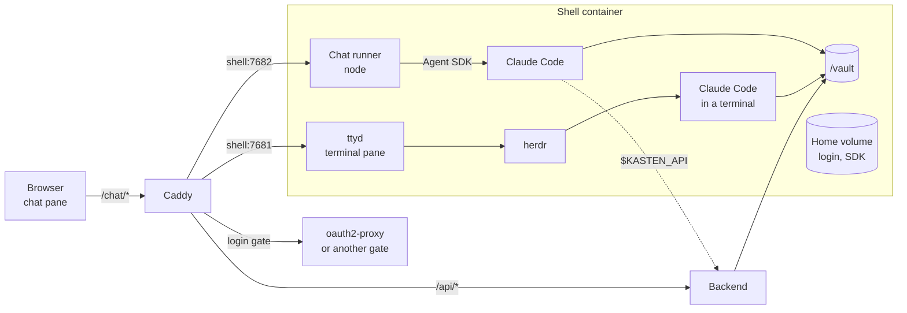
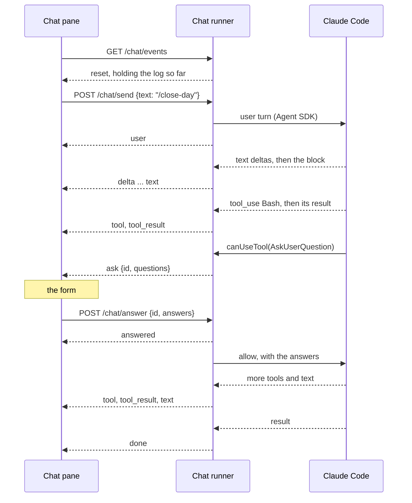

# The chat pane

Two skills in the vault, `/close-day` and `/process-meeting`, used to need a
terminal. That works at a desk and badly on a phone, where a terminal is a
small screen of escape codes and a row of stand-in keys. The chat pane runs
the same skills as a conversation. This page is why it is built the way it is.

## The shell with a different face

The pane is not a new kind of agent. It is the Claude Code that already runs in
the shell container, with the vault mounted, its login in the home volume and
the skills in `/vault/.claude/skills`. The terminal pane reaches it through
ttyd. The chat pane reaches it through the Claude Agent SDK, which starts the
same program and hands back its messages as data.

That rules out the two other ways to build it.

The Messages API alone would be a chat with no hands. Both skills run shell
commands, read images, delete files and ask questions. All of that is Claude
Code's own tool set, and building it again would be building Claude Code.

The agent API under `/agent/` has eight capabilities and no delete, on
purpose: [The agent boundary](/explanation/the-agent-boundary.md). It is the
door for an agent kasten does not trust with the whole vault. This one is
trusted with it already, by the fact of the terminal pane.

## A route of its own

The browser reaches the runner through its own proxy route, `/chat/*`, the way
it reaches ttyd through `/term/*`. The other way was through the backend, as
`/api/chat/*`.

A route of its own costs one more `handle` block in the proxy, and a missing
gate on it is as bad as one missing on `/term/*`. Through the backend the gate
would come for free.

It still won, for two reasons. The backend would have to carry a streaming
proxy and nothing else about chat, in a codebase that is otherwise about notes.
And the backend has no reach into the shell today: it mounts the shell's home
read-only to list sessions and can touch none. A proxy there would make the
backend a second way into the agent.

## HTTP and server-sent events

The runner speaks plain HTTP: one event stream out, a few posts in. Not a
WebSocket, though the terminal pane uses one.

Node has no WebSocket server of its own, so one would mean a second dependency
installed into the home volume. `node:http` needs none. And `EventSource`
reconnects by itself, which is most of what the next section needs.

The price is one proxy rule. A compressor buffers an event stream whole, so
`/chat/events` must stay uncompressed, the way `/api/events` already must.

## One session, and it outlives the page

The session lives in the runner, not in the page. The runner keeps a log of the
run and sends all of it to whoever connects, so a reload, a second pane and a
phone all see the same conversation. A skill started at a desk can be answered
from the sofa.

There is one session, not one per pane. kasten has one user, and two runs
writing the same daily note at once is a way to lose text. A message sent
during a run waits its turn.

The log is in memory. A container restart ends the session and empties the
pane. Claude Code keeps its own transcript in the home volume, so the
conversation is not lost, but the pane does not offer it back.

## Tools run unasked

The runner starts Claude Code with `bypassPermissions`: no tool call waits for
a yes. A prompt per command would turn `/close-day` into twenty taps, and it
would guard nothing, since whoever can reach the pane can reach a shell in the
same container one key away.
[Security model](/explanation/security-model.md#what-the-chat-pane-can-reach)
holds the full argument and what the runner checks instead.

A question is different. `AskUserQuestion` is the skill asking for a decision,
not for permission, and it reaches the pane in every permission mode.

## The SDK is installed on first start

The shell image is published, and the Agent SDK is Anthropic's proprietary
software, as Claude Code is. So neither is in the image. The entrypoint
installs the SDK into the home volume, at the version the image pins, the way
it installs Claude Code:
[Two environments](/explanation/environments.md).

The SDK would bring its own copy of Claude Code. The install leaves that out
and the runner uses the `claude` already there, so the terminal pane and the
chat pane share one program and one login. The cost is that the two versions
can drift: the SDK is pinned and `claude` updates itself.

## What a run looks like on the wire

## Related

* [Run a skill from the chat pane](/how-to/run-a-skill-from-the-chat-pane.md)
* [Chat runner](/reference/chat-runner.md): the routes, the events, the options
* [Security model](/explanation/security-model.md): what the pane can reach
