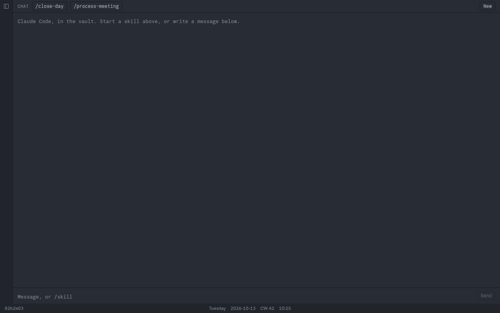
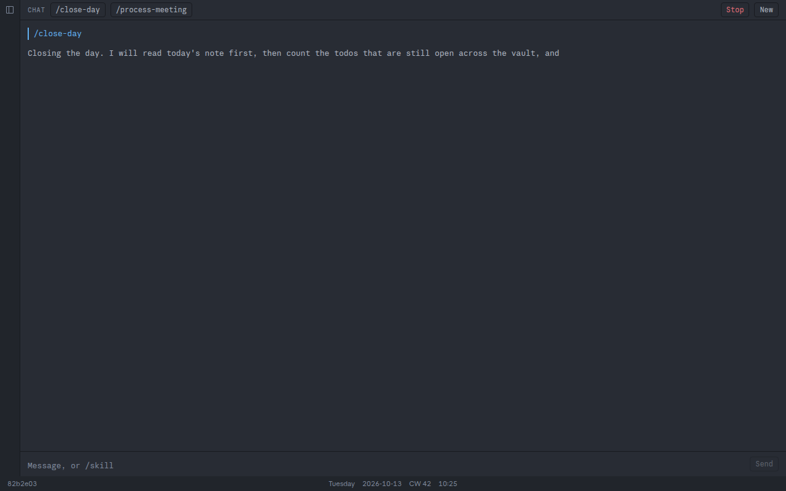
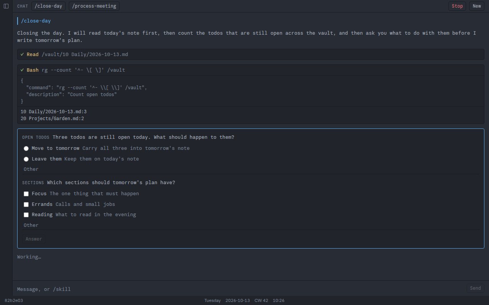
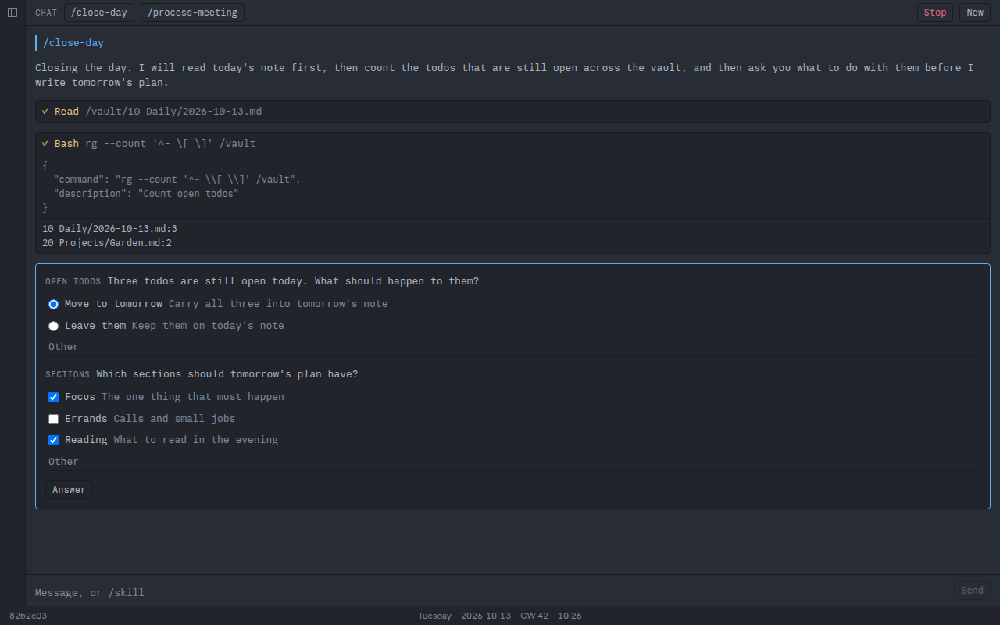
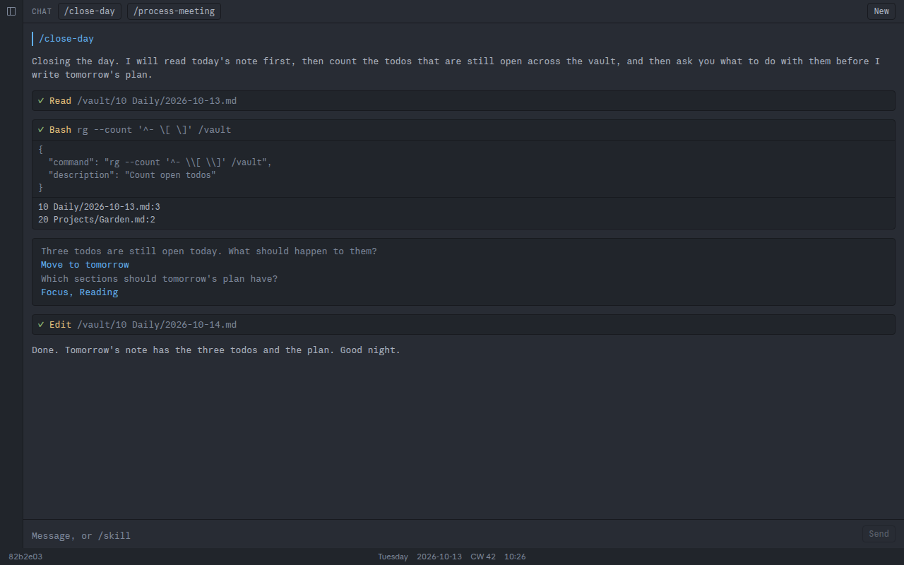
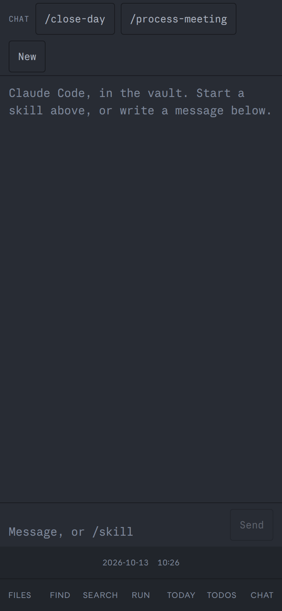
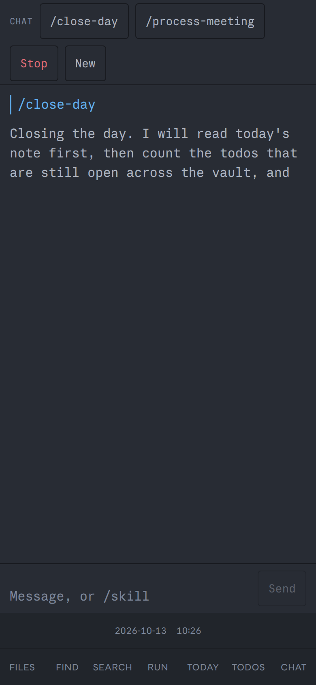
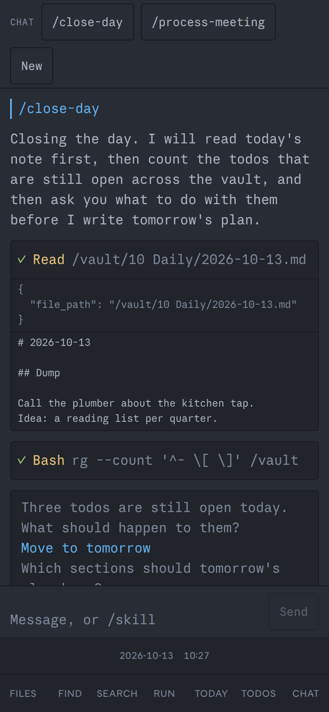
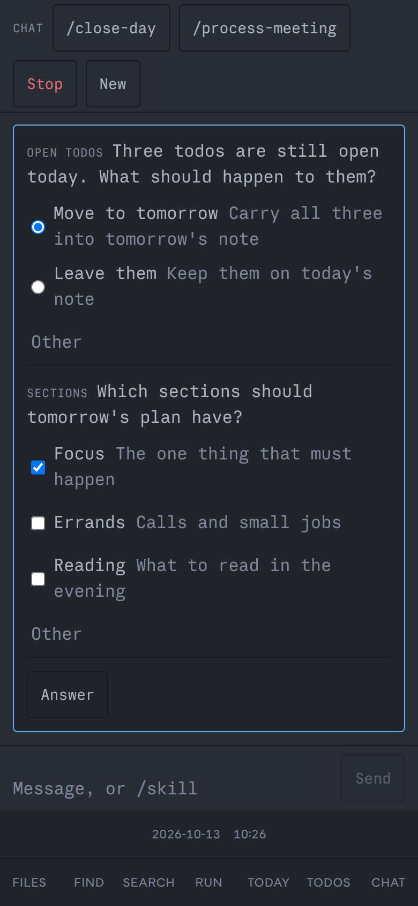
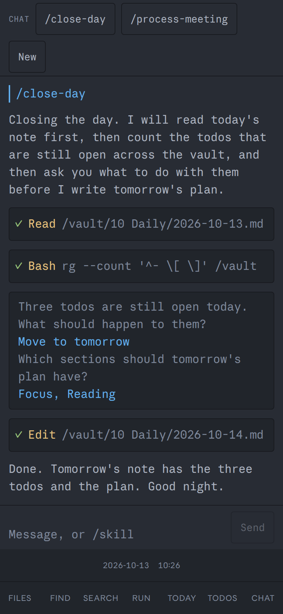

# Run a skill from the chat pane

You want to run a Claude Code skill in the vault, `/close-day` or
`/process-meeting`, without a terminal. The chat pane does that: the same
Claude Code the terminal pane runs, drawn as a conversation.

It needs Claude Code signed in once in the shell container. If the pane answers
`Not logged in`, open a terminal with `<leader>cs`, run `claude`, sign in, and
come back.

## Open the pane

Press `<leader>cc`. On a phone, tap `chat` in the toolbar.

The pane replaces what the focused pane held. `<leader>q` takes it out again.
Neither ends the session: it lives in the shell container, and opening the pane
again shows it as you left it.

## Start a skill

Click `/close-day` or `/process-meeting` in the pane's header. For any other
skill, or a plain message, press `i`, type it and press Enter. Shift+Enter
breaks the line. Escape leaves the box, so the leader works again.

Text appears as Claude writes it. `Stop` shows for as long as the run lasts.

## Read a tool call

Each tool call is one line: a mark, the tool, and what it was pointed at. `…`
means it is running, `✓` that it ended, `✗` that it failed. Click the line to
see the whole input and what came back.

Tools run without asking you first.
[Security model](/explanation/security-model.md#what-the-chat-pane-can-reach)
says why that is no wider a door than the terminal pane.

## Answer a question

When a skill asks, the run waits and the question shows as a form. Pick an
option, or several where the question takes several, or type your own answer
into `Other`. `Answer` sends it once every question has one.

The answered question stays in the conversation as what was asked and what you
said.

## Stop a run, or start over

`Stop` interrupts the turn that is running. A question still open is closed as
not answered. A message you sent while it ran was waiting its turn and still
runs. The session keeps what was said so far, so the next message goes on from
there.

`New` ends the session and empties the pane. The next message starts a fresh
one, with none of the earlier context.

## On a phone

The same pane. Enter breaks the line there and `Send` sends, since a phone's
keyboard has no Shift+Enter worth reaching for.

| Empty | Running | A tool call | A question | Finished |
| --- | --- | --- | --- | --- |
|  |  |  |  |  |

Start a skill at your desk and pick it up on the phone: both show the one
session, and a question can be answered from either.

## When it does not work

* **`Could not reach the chat runner at /chat/events.`** The shell container is
  down, the `/chat/*` route is missing from the proxy, or your login ran out.
  The pane tries again every few seconds.
  [Reverse-proxy routes](/reference/reverse-proxy-routes.md) has the route.
* **`The chat runner did not take that`.** A message, an answer or a press of
  `Stop` got no yes. Your login ran out, the runner is restarting, or the
  question was already answered from another device. What you typed is still
  in the box.
* **`Not logged in`.** Sign Claude Code in from a terminal pane, as above.
* **A skill says the calendar or the mail was not read.** The shell image has
  no `gws` and no `python3`. The skill needs both in the container, which this
  page cannot give it.

## Related

* [The chat pane](/explanation/the-chat-pane.md): why it is built this way
* [Chat runner](/reference/chat-runner.md): the routes and events behind it
* [Editor keys](/reference/editor-keys/terminal.md#the-chat-pane): every key
