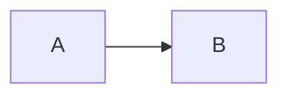

# Math and diagrams

Live preview draws math with KaTeX, ```` ```mermaid ```` blocks with mermaid,
and an inline `<svg>` block as its picture. The note keeps the source; only the
screen changes.

## Inline math

`$x^2$` draws as a formula in the line. The rules are pandoc's, which are
Obsidian's too:

* The opening `$` has a character after it that is not a space.
* The closing `$` has a character before it that is not a space, and no digit
  after it.
* The formula stays on its line. A line break before the closing `$` leaves
  it as text.
* `\$` inside a formula is a dollar and does not close it.
* `$$` in a line opens nothing.

So `$5 and $6` stays a sentence about money: the second `$` stands before a
digit and closes nothing.

## Block math

A paragraph that opens with `$$` is a block formula once a line ends with `$$`.
Written on one line:

```markdown
$$E = mc^2$$
```

Or across lines:

```markdown
$$
\int_0^1 x\,dx = \frac{1}{2}
$$
```

The block draws centred, on lines of its own. A `$$` line closes the paragraph
above it, so a block needs no blank line before it.

An opening `$$` that no `$$` closes stays text, and does not swallow the rest
of the note the way an unclosed fence does. The block ends at a blank line, or
at a line that would end a paragraph, such as a heading. If no line ended with
`$$` before that, the lines read as the paragraph they would have been.

A `$$x$$` in the middle of a paragraph stays text: a block opens only at the
head of a paragraph.

## Diagrams

A fenced code block whose language is `mermaid` draws as its diagram:

````markdown

````

The language is read without case, so `Mermaid` and `MERMAID` draw too. Any
diagram mermaid knows can go in the block.

## Inline svg

An `<svg>` block draws as its picture. The block runs from an `<svg` that
starts a line to a `</svg>` that ends one. It draws in any of three shapes:

* On one line.
* With the open tag alone on its first line, and the content and `</svg>` below
  it.
* With the open tag spread over several lines.

```markdown
<svg viewBox="0 0 10 10"><circle cx="5" cy="5" r="4" fill="currentColor"/></svg>
```

Inside a list item, a `>` quote or the middle of a paragraph, the block stays
source. A blank line inside the block splits it, and it stays source.

Before it draws, kasten rebuilds the svg from an allow list. Only these elements
survive: svg, g, defs, symbol, use, path, rect, circle, ellipse, line, polyline,
polygon, text, tspan, textPath, title, desc, marker, linearGradient,
radialGradient, stop, clipPath, mask and pattern. Any other element goes, with
everything inside it. That drops script, style, foreignObject, a, image, the
animation elements and filters.

A kept element keeps its geometry and presentation attributes. `class` and any
`on…` event handler go. `href` stays only as `#id`, and `url(...)` only as
`url(#id)`, each naming an element in the same block. Ids are renamed for each
block, so two blocks with the same marker id each keep their own, and a
reference reaches only its own block.

The root svg loses `transform`, `x` and `y`, and the picture stays inside its
box, so it cannot cover the note or the app. A `use` that points at another
`use`, or at a group holding one, is dropped, since each level multiplies the
copies.

A `style` attribute keeps only presentation properties, such as fill, stroke and
font. A value may call only `url(#id)`, `translate`, `rotate`, `scale`, `skew`,
`matrix`, `rgb`, `rgba`, `hsl` and `hsla`. Any other function, such as `var()`
or `element()`, drops its value.

`currentColor` takes the theme's ink colour, so a picture drawn in it follows
light and dark. Other colours stay as written.

A block with nothing left to draw shows the message "This svg cannot be drawn."
and its source. So does a block that holds more than the one svg, such as two
svgs on back-to-back lines or text beside the svg. On a phone the picture
shrinks to the note's width.

The cursor inside the block shows the source in any mode, as a mermaid block, a
table and a `$$` block do. A click on the picture puts the cursor there.

The allow list covers the inline svg block only. Mermaid diagrams and HTML pages
are unchanged.

## When the source shows

A math block, a diagram and an inline svg follow the table's rule: the cursor in the block,
in any mode, shows the whole block as source, and the cursor anywhere else
draws it. `j` and `k` step over a drawn block; a click, `w`, a search or a line
jump puts the cursor in it. [The three blocks](/explanation/live-preview/the-three-blocks.md#the-three-blocks)
says why.

Inline math follows the inline rule: in insert or visual mode, the formula the
cursor is inside shows its source. In normal mode the cursor steps over the
formula rather than onto a hidden `$`.

A pane with no cursor in it, read only, always draws.

## Errors

The source shows until the library has loaded and drawn it.

A formula KaTeX cannot read stays its source, in the warning colour, with the
parse error on hover.

A diagram mermaid cannot read shows mermaid's message above the block's source,
so a typo is something you can see and fix.

## Where they draw

* The editor.
* An [embed](/reference/embed-format.md), which mounts the same rendering.
* The preview pane of the finder and of search.
* The cards of a review sitting, front and back.

## Where they stay source

* **Copy as.** Neither Slack nor Teams draws math or mermaid, so the source
  goes out as code. Inline math goes in backticks, or `<code>` in the HTML
  form. A math block goes in a fence, or `<pre><code>`, `$$` and all. A
  mermaid block goes out as any fenced block does.
* **A drawn table.** Math in a cell shows as its source.
* **A quote or a list.** A math block or a mermaid block inside a `>` quote or
  indented into a list item shows its source, a block widget having to cover
  whole lines. A mermaid block there reads as a plain code block.

## Loading

KaTeX and its stylesheet load the first time a note holds math, and mermaid
the first time a note holds a diagram. A note with neither fetches neither.
When KaTeX fails to load, a formula shows its source, and the next formula
drawn tries the load again. When mermaid fails to load, a diagram shows the
error above its source, and the next diagram drawn, the same one or another,
tries the load again. A diagram mermaid cannot read keeps its error and loads
nothing new.

## Limits on a diagram

Agents write diagrams into notes, so kasten treats a diagram as text it did not
write. Mermaid runs at its strict security level: it drops `click` handlers
and passes every label through DOMPurify. A diagram takes mermaid's default
theme in light and its dark theme in dark. A switch of theme, from the palette
or from the system while no choice is stored, redraws every diagram on screen;
the old drawing stays until the new one is ready, and a diagram mermaid cannot
read keeps its error in both themes. Each theme's drawing is kept, so a switch
back shows it at once.

The drawings of every diagram on screen stay in memory, and so do the 32 most
recent others, counting a drawing that just left the screen as recent. That
covers an undo right after an edit, a switch back of theme and the last few
notes opened; an older drawing is drawn again when it comes back on screen.
